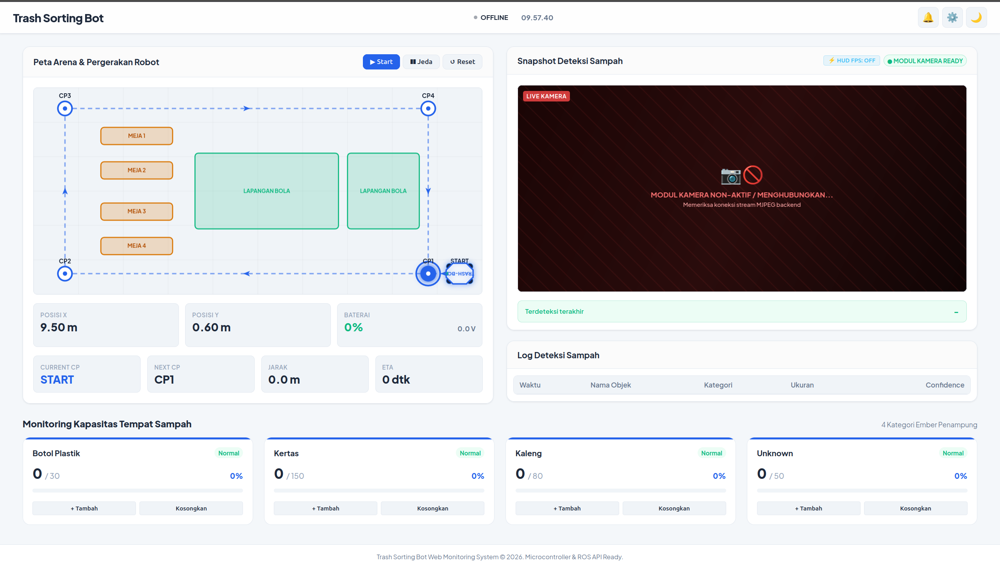

# Trash-Dumm Web Monitoring — Trash Sorting Robot

Dashboard web untuk memonitor robot pemilah sampah (*Trash Sorting Robot*) secara real-time: posisi robot di peta arena, status baterai, kamera deteksi sampah, kapasitas tempat sampah, serta kontrol manual (teleop) dari browser.



> [!NOTE]
> **Status saat ini:** robot dikendalikan **manual** (teleop keyboard). Dashboard menerima data dari simulasi Gazebo ([trash-dumm-simulation](https://github.com/YannSipemalas/trash-dumm-simulation)) atau dari robot fisik melalui HTTP. Navigasi autonomous **belum diimplementasikan**.

---

## 1. Fitur

| Fitur | Keterangan |
|---|---|
| Peta arena 2D | Canvas 10 × 6 m berisi meja/halangan dan checkpoint START, CP1–CP5. Ikon robot bergerak sesuai `posX`, `posY` dari telemetri |
| Status robot | Online/Offline, mode operasi, tegangan & persentase baterai, checkpoint, jarak, ETA |
| Heartbeat watchdog | Jika server tidak menerima telemetri > **10 detik**, status otomatis menjadi `OFFLINE` |
| Teleop dari browser | Tombol keyboard `W A S D Q E` di halaman web dikirim ke `/api/cmd_vel` |
| Kamera & deteksi AI | Menampilkan stream MJPEG dan hasil deteksi dari **server vision terpisah** di port `5000` (tidak termasuk di repo ini) |
| Kapasitas tempat sampah | 4 kategori: Botol Plastik, Kertas, Kaleng, Unknown. Status Normal / Hampir Penuh (≥ 80%) / Penuh (100%) dengan bunyi beep |
| Log deteksi & kotak alert | Disimpan permanen di SQLite, otomatis dihapus jika lebih dari 2 hari |
| Pengaturan | Ubah kapasitas maksimal tiap tempat sampah, reset semua data |
| Tema | Mode gelap / terang |

---

## 2. Arsitektur

```
 Gazebo Sim / Robot fisik                        Browser (index.html)
 ─────────────────────────                       ──────────────────────
 telemetry_web_bridge.py ── POST /api/telemetry ──┐
         ▲                                        ▼
         │                              ┌────────────────────┐
         └──── GET /api/cmd_vel ─────── │  server.py :8080    │ ◄── GET /api/telemetry (tiap 200 ms)
                                        │  + database.py      │ ◄── POST /api/cmd_vel  (tombol WASDQE)
                                        │    (trashbot.db)    │ ◄── POST reset-bin / settings / clear-all
                                        └────────────────────┘

 Server Vision/YOLO :5000 (terpisah) ── /video_feed, /api/latest_detection, /api/stats ──► Browser
```

---

## 3. Struktur Folder

```
WEB MONITORING TRASHBOT/
├── index.html          # Halaman dashboard
├── css/styles.css      # Tampilan (dark/light theme)
├── js/
│   ├── telemetry.js    # State telemetri, kapasitas tempat sampah, alert & beep
│   ├── arena.js        # Render peta arena 2D & posisi robot
│   ├── vision.js       # Stream kamera MJPEG + overlay bounding box & HUD FPS
│   └── app.js          # Controller UI, polling API, teleop keyboard
├── server.py           # HTTP server + REST API (port 8080, otomatis cari port kosong s/d 8089)
├── database.py         # SQLite: bin_capacities, detection_logs, system_alerts
├── simulator.py        # Simulator telemetri dummy (robot bergerak START → CP1 … CP5)
└── assets/
```

> `trashbot.db` dibuat otomatis saat server pertama kali dijalankan.

---

## 4. REST API (server.py)

| Method | Endpoint | Fungsi |
|---|---|---|
| `GET` | `/api/telemetry` | Telemetri terakhir + data tempat sampah, log deteksi, dan alert |
| `POST` | `/api/telemetry` | Robot/simulasi mengirim telemetri. Jika ada `detectedObject`, otomatis dicatat ke database |
| `GET` | `/api/cmd_vel` | Perintah gerak terakhir dari web (dibaca oleh bridge robot) |
| `POST` | `/api/cmd_vel` | Kirim perintah gerak `{linearX, linearY, angularZ}` |
| `POST` | `/api/add-detection` | Tambah satu item sampah terdeteksi |
| `POST` | `/api/reset-bin` | Kosongkan satu tempat sampah |
| `POST` | `/api/settings` | Ubah kapasitas maksimal tempat sampah |
| `POST` | `/api/clear-all` | Hapus semua data sampah, log, dan alert |

Contoh payload `POST /api/telemetry`:
```json
{
  "connected": true,
  "cameraConnected": true,
  "operationState": "Ready",
  "posX": 9.50,
  "posY": 0.60,
  "currentCP": "START",
  "nextCP": "-",
  "distanceToNext": 0.0,
  "etaSeconds": 0,
  "batteryVoltage": 12.5,
  "batteryPct": 95
}
```

---

## 5. Kontrol Teleop dari Browser

Klik halaman dashboard, lalu tekan (bisa dikombinasikan):

| Tombol | Aksi | Nilai |
|---|---|---|
| `W` / `S` | Maju / Mundur | linearX ±0.5 m/s |
| `Q` / `E` | Geser kiri / kanan | linearY ±0.5 m/s |
| `A` / `D` | Putar kiri / kanan | angularZ ±0.8 rad/s |
| Lepas tombol | Berhenti | 0 |

---

## 6. Cara Menjalankan

**Kebutuhan:** Python 3 (server hanya memakai library bawaan). `simulator.py` butuh `pip install requests`.

### Step 1 — Jalankan server
```bash
cd "/home/yanzz/Documents/WEB MONITORING TRASHBOT"
python3 server.py
```

### Step 2 — Buka dashboard
Buka `http://localhost:8080` di browser.

### Step 3 — Kirim data telemetri (pilih salah satu)
- **Simulasi Gazebo:** jalankan `./run_simulation.sh` dari repo [trash-dumm-simulation](https://github.com/YannSipemalas/trash-dumm-simulation)
- **Simulator dummy (tanpa Gazebo):**
  ```bash
  python3 simulator.py
  ```

Tanpa data telemetri, dashboard akan menampilkan status `OFFLINE`.

### Step 4 — (Opsional) Kamera & deteksi AI
Jalankan server vision/YOLO di port `5000` yang menyediakan `/video_feed`, `/api/latest_detection`, dan `/api/stats`. Tanpa server ini, panel kamera tampil tidak terhubung.

---

## 7. Catatan & Rencana Pengembangan

- [ ] Tombol **Start / Jeda / Reset** di panel peta belum berfungsi (fungsinya belum ada di `arena.js`)
- [ ] Field `currentCP`, `nextCP`, `distanceToNext`, `etaSeconds` belum dihitung oleh simulasi Gazebo (masih nilai tetap)
- [ ] Navigasi autonomous START → CP1 → … → CP4
- [ ] Data baterai masih simulasi, belum dari sensor nyata
- [ ] Menyertakan server vision/YOLO (port 5000) ke dalam repo
